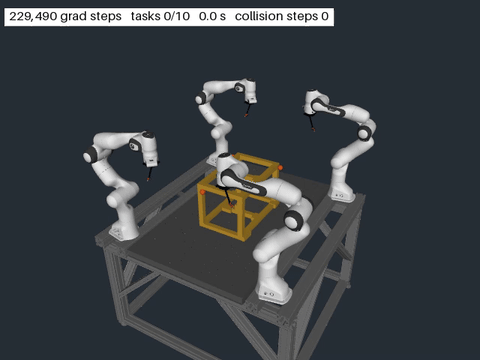
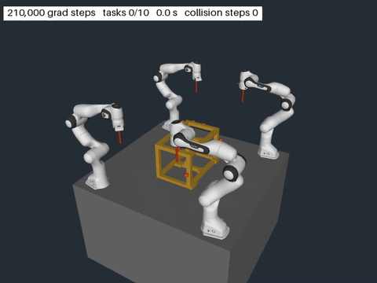
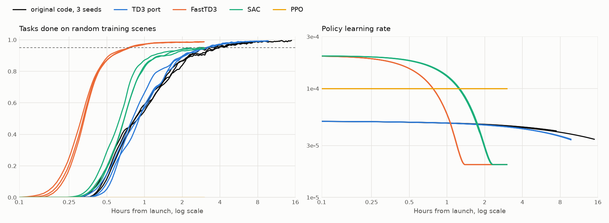
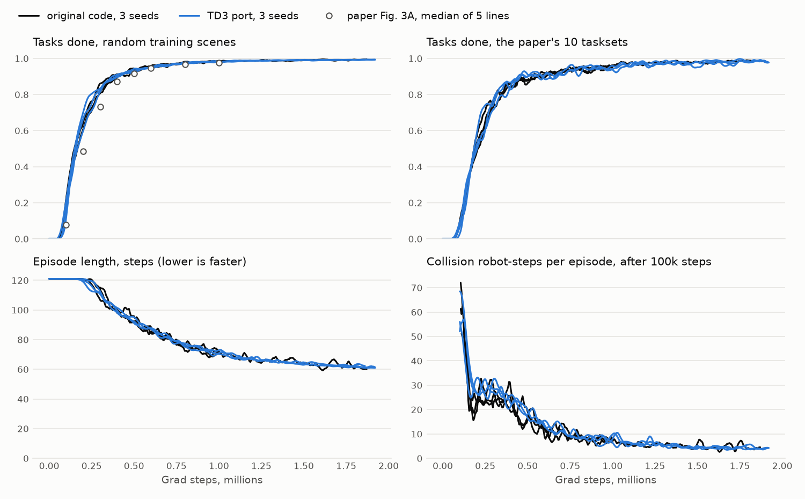

# roboballet-mjlab

[RoboBallet](https://doi.org/10.1126/scirobotics.ads1204) (a graph-network policy trained with TD3 and hindsight) ported to [mjlab](https://github.com/mujocolab/mjlab) and MuJoCo Warp. On the same env: FastTD3, rsl-rl SAC and rsl-rl PPO.

| FastTD3 w/ original mesh | FastTD3 w/ collision sphere |
|---|---|
|  |  |

## Results

**Hours to the paper's 95% of tasks solved.** 4 robots, 10 targets, 30 obstacles. One B200 per run, hours from launch. 

| | 95% | 98% | Tasks solved after 3 h | Seeds |
|---|---:|---:|---:|---:|
| Paper, (A100 & 64 CPU cores) | 6 to 24 h | | | |
| Same code, this machine (B200, 72 CPU Cores) | 3.5 to 4.1 h | 5.7 to 6.7 h | 0.91 to 0.94 | 3 |
| same code, only TD3 tuned for this machine | 3.3 h | 4.6 to 5.1 h | 0.94 | 3 |
| **FastTD3** | **0.8 to 0.9 h** | **1.2 to 1.4 h** | **0.986 to 0.988** | 3 |
| rsl-rl SAC | 2.8 h, 1 seed of 3 | | 0.94 to 0.95 | 3 |
| rsl-rl PPO | never | | 0.00 | 3 |



FastTD3 is **4x faster to 95%** than the original on the same machine.  PPO cannot learn this sparse task without hindsight due to the dense reward of the code. Agents and every setting changed: [docs/BENCHMARK.md](docs/BENCHMARK.md).

**The TD3 port matches the original.** Same task, network, TD3 and hindsight, 3 seeds each.

| | Original | TD3 port |
|---|---:|---:|
| Grad steps to 95% | 578k to 606k | 620k to 640k |
| Tasks solved at 1M grad steps | 0.979 to 0.985 | 0.980 to 0.984 |
| Episode length at 1M, steps | 70.0 to 73.6 | 70.1 to 72.5 |
| Collisions at 1M, robot-steps | 7.4 to 7.9 | 6.3 to 8.3 |
| One policy scored by the original's evaluator and by the port's | 0.9931 and 0.9931 | 0.9897 to 0.9916 and 0.9905 to 0.9919 |



The last row is the final policies: the original's at 1.87M grad steps, the port's 3 seeds at 1.8M. The port runs 1.4 to 1.6x as many grad steps per second and averages 1 CPU core, where the original was given 64. Details and the differences that remain: [docs/evidence/](docs/evidence/).

**Final policies,** 4,096 random scenes and 1,280 taskset episodes each.

| | Training | Tasks solved | All 10 solved | Episode length | Collisions | Paper's tasksets |
|---|---|---:|---:|---:|---:|---:|
| Original, seed 1 | 1.87M steps, 15 h | 0.993 | 0.94 | 61 | 4.4 | 0.986 |
| TD3 port, 3 seeds | 1.8M steps, 9.1 to 9.4 h | 0.991 to 0.992 | 0.92 to 0.93 | 61 to 63 | 3.2 to 4.8 | 0.972 to 0.989 |
| FastTD3, 3 seeds | 3 h | 0.986 to 0.988 | 0.88 to 0.89 | 70 to 71 | 2.3 to 2.7 | 0.974 to 0.981 |
| rsl-rl SAC, 3 seeds | 3 h | 0.940 to 0.951 | 0.55 to 0.61 | 91 to 94 | 2.8 to 3.3 | 0.915 to 0.935 |
| FastTD3, sphere arm, 3 seeds | 3 h | 0.976 to 0.982 | 0.81 to 0.85 | 74 to 76 | 3.0 to 3.3 | 0.80 to 0.84 |

The sphere arm ran before FastTD3's exploration decay was added. Its training scenes are its own, regenerated for the stick, and the paper's tasksets were made for the original's tilted tool. On tasksets regenerated for the stick it solves 0.985 to 1.000.

## Same and different

| Same as the original | Different |
|---|---|
| Task, reward, observations, episode end | Simulator: MuJoCo Warp on the GPU, all worlds in one process, instead of 64 CPU actors |
| Graph network, TD3, hindsight, replay rules | Framework: PyTorch instead of JAX, with the original's bf16 rounding reproduced |
| Evaluation rules (no exploration noise, same metrics) and sets | Evaluation size: 1,024 episodes every 20k steps in the trainer, instead of 50 on separate CPU evaluators |
| | New: FastTD3, SAC, PPO, and an arm of 36 collision spheres with a straight stick |
| Hyperparameters of the TD3 agent | Each check, with numbers: [docs/evidence/](docs/evidence/) |

## Install

Linux x86-64 with an NVIDIA GPU and a CUDA 13 driver. The results here used driver 580.95.05 (CUDA 13.1) with PyTorch's CUDA 13.2 build.

```bash
uv sync
uv run ballet-fetch-data     # the original's files from Zenodo (1.1 GB download, 1.7 GB on disk) and the scene pools (460 MB)
```

The scene pools are this repository's release assets, so `gh auth login` or `GH_TOKEN` is needed while the repository is private.

## Run

```bash
uv run ballet-train RoboBallet-4R10T-Mesh --agent fasttd3 --stop-after-seconds 10800
uv run ballet-eval  RoboBallet-4R10T-Mesh --checkpoint logs/RoboBallet-4R10T-Mesh/fasttd3/<run>/checkpoint.pt
uv run ballet-play  RoboBallet-4R10T-Mesh --checkpoint logs/RoboBallet-4R10T-Mesh/fasttd3/<run>/policies/<snapshot>.pt --video demo.mp4
```

- Agents: `fasttd3` (default), `td3` (the original's), `sac`, `ppo`. Tasks: `RoboBallet-4R10T-Mesh` (the original's arm and stored scenes), `RoboBallet-4R10T-Spheres` (sphere arm), and the 8-robot, 40-target versions. `ballet-train --help` lists the presets.
- Runs go to `logs/<task>/<agent>/<date>/` under the current directory. FastTD3 keeps a policy snapshot every 10k grad steps.
- `ballet-play` evaluates the policy first. `--video-only` skips that. Rendering is EGL: pick the device with `--egl-device` or `MUJOCO_EGL_DEVICE_ID`.
- The commands carry a `ballet-` prefix because mjlab installs its own `train` and `play`, which cannot run this direct-style env.

## More

[docs/LAYOUT.md](docs/LAYOUT.md) (files), [docs/PROFILING.md](docs/PROFILING.md) (where the time goes), [docs/DESIGN.md](docs/DESIGN.md) (decisions). The `test` branch adds the tests and scripts that check sameness with the original: 1,092 tests pass on a B200.

Apache 2.0, as the original. Credits and third-party notices: [NOTICE](NOTICE), [third_party/](third_party/).
