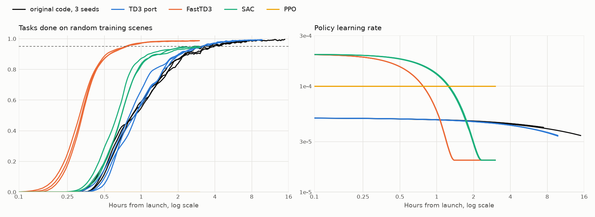

# Benchmark: four agents on one env

4 robots, 10 targets, 30 obstacles, the mesh arm with the original's tool, the original's 50,000 stored start states. Every run has one B200 to itself and pins its host work to 8 cores. Hours are from process launch to the learner reaching the step, so they include start-up and, for this repository's agents, in-process evaluation. A milestone is the first evaluation whose trailing mean reaches the task rate: 3 evaluations of 1,024 episodes for this repository's agents, a 50k-step window of the original's 50-episode evaluations.

## Milestones, every seed

| Agent | Seed | 50% | 90% | 95% | 97% | 98% | Ran |
|---|---:|---:|---:|---:|---:|---:|---:|
| Original code | 1 | 1.01 h | 2.51 h | 3.46 h | 4.84 h | 6.05 h | 14.9 h |
| | 2 | 1.02 h | 2.72 h | 3.94 h | 5.58 h | 6.70 h | 7.4 h |
| | 3 | 1.09 h | 2.51 h | 4.07 h | 5.32 h | 5.69 h | 7.3 h |
| TD3 port | 1 | 1.14 h | 2.17 h | 3.32 h | 4.01 h | 4.60 h | 9.7 h |
| | 2 | 1.05 h | 2.26 h | 3.31 h | 4.24 h | 5.06 h | 9.7 h |
| | 3 | 0.96 h | 2.16 h | 3.30 h | 4.00 h | 4.81 h | 9.7 h |
| FastTD3 | 1 | 0.41 h | 0.64 h | 0.86 h | 0.98 h | 1.24 h | 3 h |
| | 2 | 0.41 h | 0.64 h | 0.81 h | 1.09 h | 1.29 h | 3 h |
| | 3 | 0.41 h | 0.58 h | 0.80 h | 1.08 h | 1.39 h | 3 h |
| rsl-rl SAC | 1 | 0.76 h | 1.57 h | not in 3 h | | | 3 h |
| | 2 | 0.75 h | 1.23 h | 2.79 h | | | 3 h |
| | 3 | 0.80 h | 1.54 h | not in 3 h | | | 3 h |
| rsl-rl PPO | 1, 2, 3 | never | | | | | 3 h each |

The original's seeds 2 and 3 ran while this repository's runs used the other GPUs and 8 of the 72 cores, so their hours are less clean than seed 1's.

In grad steps, FastTD3 reached 95% after 56k to 60k, the original after 578k to 606k. A FastTD3 grad step uses a batch of 2,048 against the original's 128.

## Agents and what was tuned

The MDP is the same for every agent: states, actions, transitions, the reward, the discount 0.94, and the original's hindsight relabelling where the agent has a replay. Tuning changed only the learning algorithm's settings. Each change, with the reference value:

| Agent | Source | Setting used | Changed from the source's default, and why |
|---|---|---|---|
| TD3 port | RoboBallet's TD3, reproduced | The original's, unchanged | Nothing. This is the parity agent |
| FastTD3 | FastTD3 at 229ed59 (MIT) | Preset `fasttd3` | 3-layer GNN instead of the paper's 7 (earlier take-off). LR 2e-4 for both, from 3e-4 (the 7-layer GNN collapses to a constant output above about 1e-4). 3-step returns, from 1 (the reference's own `num_steps` option). Cosine LR to 10% over 100k grad steps (the reference's `*_learning_rate_end` option): fixed rates plateau at 0.955 to 0.98. Exploration cap 0.4 cosine-decayed to 0.1 over the same steps, not in the reference: the original decays its sigma 0.8x per 100k steps, and one seed gained 0.3 to 0.6 points with it |
| rsl-rl SAC | rsl_rl_sac at e0d243a (BSD-3) | Preset `sac` | 3-layer GNN. The paper's Table C9 values (LR 2e-4, temperature LR 2e-5, initial temperature 0.001, tau 0.003, target entropy scale 0.167, policy every step, initial std 0.15): at the code's defaults the GNN collapses, also with the fork's own update. Std capped at e^-1 (log_std_max -1): uncapped, the std grew to 0.8 and the task rate fell back to 0. 5-step returns, the paper's value. Cosine LR to 10% over 150k grad steps. Tried and dropped: target entropy scale 1.0 (slower, 0.918 at 88k grad steps), temperature LR 1e-3 (slow, 0.17 at 20k), target entropy scale 1.0 with temperature LR 1e-4 (0.000 at 28k) |
| rsl-rl PPO | rsl-rl-lib 5.4.2, as mjlab pins it | Preset `ppo` | 3-layer GNN. Fixed LR 1e-4: rsl-rl's adaptive LR makes the GNN's output constant within one iteration. No further tuning, by decision: PPO has no hindsight and the sparse task gives it no signal |

All four use 1,024 worlds per GPU except the TD3 port (64, as the original's 64 actors), and the same evaluator and evaluation sets.

**PPO cannot learn this task without hindsight.** Task rate 0.000 at every evaluation of all 3 seeds, about 1.2e8 env steps each. A review found no defect in the wiring: with a hand-made dense reward on a 1-robot, 1-target task, the same code reached 0.46 at 1.4e7 env steps, where the real sparse reward stayed at 0.000. Reward shaping would change the task, so it was not pursued.

## Learning rate

The right panel of the figure above. The original and the TD3 port decay the policy LR 0.98x and the critic LR 0.95x per 100k grad steps from 5e-5. FastTD3 and SAC follow their cosines. PPO stays at 1e-4.

## Several GPUs

Two GPUs at the same total batch gave 1.34x the grad-step rate. Two GPUs at twice the total batch gave no fewer grad steps to a given task rate. So every run here uses one GPU. See [PROFILING.md](PROFILING.md).
